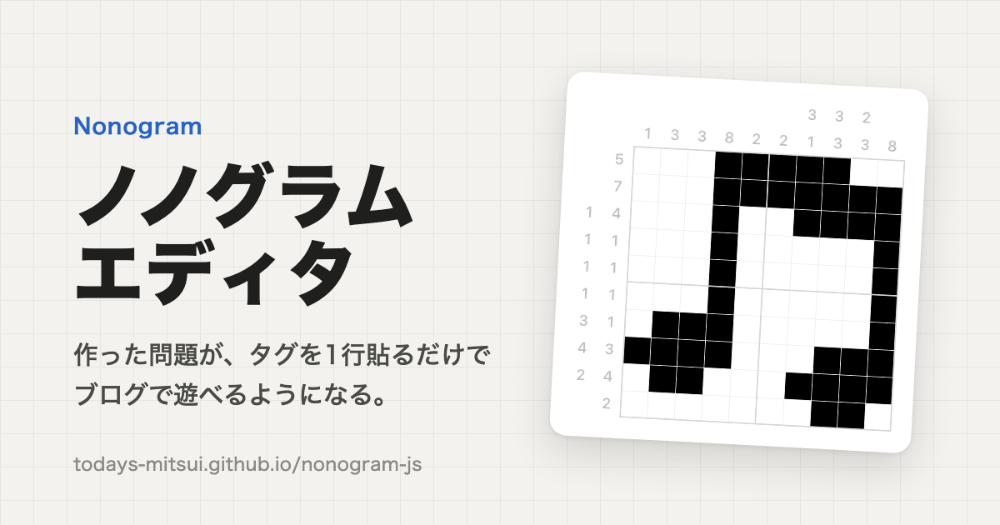

# nonogram-js

ノノグラム(お絵かきロジック)の問題を作り、ブログなどの Web ページに貼って遊んでもらうためのエディタとプレイヤー。

- **エディタ**: https://todays-mitsui.github.io/nonogram-js/
- **使い方**: https://todays-mitsui.github.io/nonogram-js/guide/
- **遊ぶ画面の見本**: https://todays-mitsui.github.io/nonogram-js/demo/



## 使い方

1. [エディタ](https://todays-mitsui.github.io/nonogram-js/)で絵を描く(16 色まで。一意に解けるかは自動で調べる)
2. 「書き出し」で「タグをコピー」を押す
3. ブログ記事の HTML に貼る

```html
<div
  class="todays-mitsui__nonogram"
  data-solution="v2;5x5;5x5;#000;Y2BkAEI4ADEZGIBCDAA"
  data-aspect-ratio="1:1"
>
  ここにノノグラム(パズル)があります。JavaScript が動く環境で開くと遊べます。
</div>
<script src="https://todays-mitsui.github.io/nonogram-js/player/v1/player.js" defer></script>
```

サーバーもアカウントも要らない。作品はエディタを開いたブラウザに、解きかけの盤面は解く人のブラウザに保存される。詳しくは[使い方](https://todays-mitsui.github.io/nonogram-js/guide/)を参照。

エディタは [WebMCP](https://github.com/webmachinelearning/webmcp) に対応していて、対応したブラウザでは AI エージェントから操作できる。

## 仕様

タグと正解図コードは公開仕様。エディタを使わずに手で書いたり、ほかのツールで作ったりしてよい。

| 文書                                 | 内容                                                        |
| ------------------------------------ | ----------------------------------------------------------- |
| [EMBED.md](docs/spec/EMBED.md)       | 埋め込みタグの書き方と `player.js` の振る舞い、互換性の約束 |
| [FORMAT.md](docs/spec/FORMAT.md)     | 正解図コード(`data-solution` の値)の形式                    |
| [PROGRESS.md](docs/spec/PROGRESS.md) | 進捗コードと保存キー                                        |
| [GLOSSARY.md](docs/spec/GLOSSARY.md) | 用語集                                                      |

設計の全体は [docs/README.md](docs/README.md)、作業の進み具合は [docs/tasklist.md](docs/tasklist.md)。

## 開発

Node.js 26(`.node-version`)。

```sh
npm ci
npm run dev       # 開発サーバー
npm test          # テスト
npm run lint
npm run format:check
npm run build     # dist/ にサイトと player.js(dist/player/v1/)を作る
```

`main` に push すると、GitHub Actions がテストのあと GitHub Pages にデプロイする。

## ライセンス

MIT([LICENSE](LICENSE))
